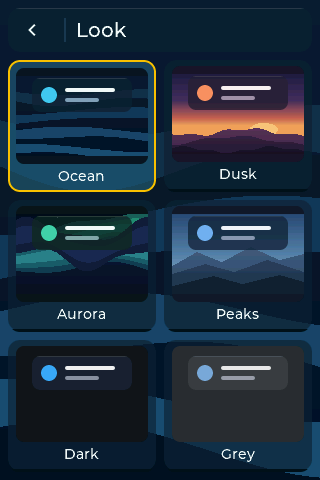

# LVGL as the panel's UI

On a panel whose display runs an [nspanel-terminal](https://github.com/ptaru/nspanel-terminal) TFT,
the firmware draws every page itself with [LVGL](https://lvgl.io) 9.6 and streams the pixels to the
display at 4 Mbaud. LVGL is the only UI: on NSPanel Manager's own (legacy) TFT the firmware shows
no pages, only "Display update needed" on the TFT's boot screen, until a GUI update installs the
terminal TFT. NSPM's pages, data, navigation and manager protocol are unchanged; only the drawing moves.

## How it fits together

| Part | Where | Does |
|---|---|---|
| Mode | `lib/LvglUi/LvglUi.cpp` (`init()`) | LVGL is the UI when the display reports a terminal TFT (`NextionTerminal::is_receiver()`) and sent no NSPM startup flag. Otherwise there is no UI (`InterfaceManager` shows no page but `LoadingPage`): on NSPM's TFT the legacy screen (`DISPLAY_MODE_NEXTION`, register_request feature `no_hmi`), on anything else nothing (`DISPLAY_MODE_TERMINAL_IDLE`) |
| Page adapters | `lib/Pages/*` (`LvglUi::active()` branches) | Where a page would drive the Nextion, it hands a view's state to `LvglUi::show()`; view actions call the same handlers the Nextion touch events did |
| Host | `lib/LvglUi/` | Screensaver timeout and wake, gestures (below), touch sound, backlight, album art fetch (`LvglArt`), Latin-1 text (`LvglText`) |
| Views | `lib/LvglRenderer/*View.cpp`, `Theme`, `Ui`, `Background` | The screens, free of ESP-IDF (the host simulator builds them) |
| Renderer | `lib/LvglRenderer/LvglRenderer.cpp` | LVGL's task, draw buffer, touch input, boot screen |
| Transport | `lib/NextionTerminal/` | The terminal session; see its README |
| Nextion | `lib/Nextion/` | In LVGL mode: commands and queries dropped (`set_commands_blocked`), pages redirected to LVGL, brightness to the receiver |

Threads: LVGL runs on its own task (core 1) and nothing else calls it; other tasks `post()` work to
it. View actions run there too, so they `LvglUi::defer()` anything that publishes or changes pages.
The terminal task (core 0) encodes and sends while LVGL renders the next band.

## Gestures

`LvglUi::_touch()` sees every touch before LVGL does, and recognises the swipes itself (LVGL's own
gesture detection missed them on Office):

| Where | Gesture | Does |
|---|---|---|
| Any page but the screensaver, the loading page and the timer alarm | Swipe down, starting in the top 72 px, 48 px or more | Opens the menu; on the menu and its pages (Look, Clean screen, Timers), back to Home. Only from the top edge, so a drag lower down stays with what is under the finger (a landscape panel's vertical sliders, a list) |
| Screensaver, with two or more cards in the rotation | Swipe left / right, 80 px or more | The next / previous card, which then stays twice its time; the panel sleeps on |
| Screensaver | Anything else | Wakes the panel. With cards to turn between it wakes on the release, not the press, so that a swipe can be told from a tap |

Once a swipe-down is recognised, LVGL is told to drop the press (`LvglRenderer::cancel_press`), so
the header button or slider it started on is not clicked or set. A release whose coordinates do not
map (255,255 on Kitchen) is delivered at the last point that did (`NextionTerminal`).

## The home page's controls

The home page shows only the controls the room's lights need (or every room's, in "All rooms"
mode), from the room status (`NSPanelRoomStatus`), counting only lights controlled from the main
page:

| Control | Shown when | Hidden |
|---|---|---|
| Ceiling tile | `num_ceiling_lights > 0` | the Table tile takes the row |
| Table tile | `num_table_lights > 0` | the Ceiling tile takes the row |
| Colour-temperature slider | `num_color_temperature_lights > 0`, or `color_temperature_lights_known` unset | the tiles take its share of the height (width, landscape); the brightness card keeps its size |
| Tiles and both sliders | either group has a light | "No lights in this room" in their place |

Until a status arrives everything is shown. Every manager sends the two group counts, so they are
used as they are. The colour-temperature count is newer: a manager from before it sends neither it
nor `color_temperature_lights_known`, and a missing count must not read as 0 (the slider shows, as
it always has). `average_color_temperature` can't tell either: it is 0 both without such lights and
in a room turned fully warm.

The Nextion home page is unchanged. Its cards, icons and slider tracks are drawn in the page's
background picture, and the controls are crops of it (`sta = 0`, `picc` = the background), so
`vis` would leave the card and its artwork in place with nothing to drag. Hiding them cleanly needs
new background pictures for every combination, i.e. an HMI change.

## Commands

On `nspanel/<MAC>/command`:

| Command | Effect |
|---|---|
| `{"command": "lvgl_ui", "enable": false}` | No longer supported: logged and ignored (it kept the HMI pages, which are gone). A saved `lvgl_ui: false` in `config.json` is ignored too, and dropped at the next save |
| `{"command": "lvgl_background", "preset": "ocean"}` | Page background: `none`, `ocean`, `dusk`, `aurora`, `peaks`, `vesuvius`, `parthenon` (saved; applied at once; reported, see "The look") |
| `{"command": "lvgl_theme", "theme": "grey"}` | Colours (`Theme::Palette`): `auto` (the default: the background's own palette, `dark` without one), `dark`, `grey`, `ocean`, `dusk`, `aurora`, `peaks`, `vesuvius`, `parthenon` (saved; applied at once; reported). `light` is taken as `grey`: the white palette it named was too bright from above. A tile or menu item that is on takes the palette's accent, mixed into its card |
| `{"command": "loop_watchdog", "enable": true}` | Turn the event-loop watchdog (`EventLoopWatchdog`) on or off: when the default event loop stops dispatching for 15 s it logs every task's backtrace. Off by default (it costs a task and its stack). Saved in `config.json` and applied at once, with no reboot; a repeat of the current state does nothing. Without `enable` it logs the current state. Not LVGL-specific, listed here with the other panel commands |
| `{"command": "lvgl_tap", "x": 160, "y": 20, "hold_ms": 100}` | A touch through the LVGL path, for testing without a finger; `x2`/`y2` make it a swipe |

Both look commands do nothing when they repeat the look in use (no flash write, no repaint).

## The look

The look is a page background and a palette (`ConfigManager::lvgl_background` / `lvgl_theme`, saved
in `config.json`, so the boot screen has it before the manager answers). It is set three ways, all
through `LvglLook` (`lib/LvglUi/LvglLook.cpp`):

| From | How | Reported to the manager |
|---|---|---|
| The manager's config | `NSPanelConfig.lvgl_theme` (49) / `lvgl_background` (50), on every config. Empty: not managed, keep the panel's own. Applied only when it differs | No: the manager knows it |
| The commands above | Applied at once | Yes |
| The person at the panel | Swipe down, **Look**: a page of eight looks (`LookView`, `Looks::ALL`): Ocean, Dusk, Aurora, Peaks, Vesuvius and Parthenon (that background with `auto`, its own palette), Dark and Grey (no background). The look in use has the amber outline; a tap applies, saves and reports, and the page stays | Yes |



The picker shows each look as a small screen: the background's art scaled from `Background::render_row()`
into LVGL's heap when the page is built (132x96, 25 KB each, freed with the page; nothing in flash),
with a card in the palette's card, text and accent colours. On a landscape (EU) screen, where no
background is drawn, the previews are the palette's colours only. A combination the manager set that
is not one of the six (say `grey` over `ocean`) selects none. Panels on NSPM's TFT have neither the
menu nor the page (`LookPage::show()` returns unless `LvglUi::active()`).

### Reporting, and who wins

A look set on the panel (picker or command) is reported to the manager as a command on its
protobuf command topic, like the panel's other actions: `NSPanelMQTTManagerCommand.lvgl_look`
(`LvglLook { theme, background }`, field 11, with the panel's `nspanel_id`), names made canonical
(`light` is `grey`, unknown names `auto` / `none`). It stays **unconfirmed**
(`ConfigManager::lvgl_look_unconfirmed`, saved, so a reboot keeps it) until a config arrives whose
look (both fields) is the same; a manager that knows the report saves it as the panel's settings and
answers with exactly that config. While it is unconfirmed:

- a config with another look is not applied: it was sent before the manager had the report (a
  settings save crossing it), or it is the retained config replayed after a reconnect or boot;
- that config makes the panel send the report again, at most every 10 s
  (`LvglLook::REPORT_INTERVAL_US`): it covers a report lost (QoS 0, or MQTT was down when the look
  was picked) and a manager that was not running. The spacing is the guard against a manager that
  answers a report with another look: the two cannot go back and forth faster than that.
- a command still applies (it is the newest explicit change), and becomes the unconfirmed look.

So the newest change wins, with one tie-break: a look picked on the panel while it could not reach
the manager beats a change made in the manager meanwhile, as the panel cannot tell their order and
somebody standing at it saw the result.

`register_request` lists `"features": ["lvgl_look"]`. A manager that knows it sends this panel no
`lvgl_theme` / `lvgl_background` commands, only the config. That matters: those commands are not
answers to anything, so one sent on registration would overtake a report still on its way.

| Manager | What happens |
|---|---|
| Knows the report (NSPanelManager `feat/lvgl-look-from-panel`) | Picks are saved as the panel's settings and show on its settings page; the config confirms them; later changes in the manager reach the panel through the config |
| Sends config fields and commands but not reports (`feat/lvgl-panel-mode`) | A pick works and survives reboots. It stays unconfirmed: configs with the manager's look are ignored, and the report is sent again (to nobody) with each config, at most every 10 s. A command (a change in the manager's settings, or the look it sends once per manager start) replaces the pick. To keep picks, leave the panel's look on "Keep the panel's own" there |
| Neither (upstream NSPM) | A pick works and survives reboots; the config's look fields are absent (empty), so nothing replaces it. The report goes to a topic nobody subscribes to: no error on the manager |

The status report also says what the display shows (`display_mode`: `NEXTION`, `LVGL`, or
`TERMINAL_IDLE` for a terminal TFT with LVGL off or failed to start; `LvglUi::display_mode()`) and,
in LVGL mode, the look in use (`lvgl_theme`, `lvgl_background`).

The protobuf-c files in `lib/ProtoBuf` are copied from NSPanelManager's `protobuf_firmware/` on
`feat/lvgl-panel-mode` (protoc 27.0, protobuf-c 1.4.1): fields added only, nothing renumbered. The
config grows by at most ~20 bytes and the status report by ~20, far inside the 4 KB MQTT buffer.

## Screenshots

`GET http://<panel>/screenshot` on the panel's own web server returns the screen as LVGL draws it,
upright and in screen coordinates (320x480 US, 480x320 EU), whatever the receiver's rotation. No
auth, like the rest of that server. There is no MQTT command for it yet.

```
curl -o office.png http://<panel-ip>/screenshot
curl -o office.bmp 'http://<panel-ip>/screenshot?format=bmp'
```

| `format=` | Body | Size (320x480) |
|---|---|---|
| `png` (default) | 8-bit RGB, deflate (ROM `tdefl`, fastest setting), chunked | typically 5-50 KB |
| `bmp` | 16-bit `BI_BITFIELDS` (565 masks), top-down, chunked | 307,266 B |
| `raw` | RGB565 little-endian, row by row, with `Content-Length` | 307,200 B |

Headers: `X-Width`, `X-Height`, `X-Capture-Ms` (the GUI task's time on it), `X-Display-Streaming`
(`1` when the receiver was streaming and nothing was left to repaint, so the display shows exactly
this; `0` while the terminal restarts or after a band failed), `Cache-Control: no-store`,
`Content-Disposition: inline; filename="<hostname>.<format>"`, and for `raw`
`X-Pixel-Format: RGB565LE`.

| Status | When |
|---|---|
| 200 | The image |
| 400 | `format` is not `png`, `bmp` or `raw` |
| 409 | The panel shows NSPM's Nextion pages (`LvglUi` not active): the Nextion draws those itself and nothing can be read back |
| 503 | Another screenshot is under way, no PSRAM for the 300 KB copy, the GUI queue is full, or the GUI task took over 2 s (`Retry-After: 1`) |

How (`LvglRenderer::capture()`, `lib/LvglUi/LvglScreenshot.cpp`, `WebManager`): neither the ESP32 nor
the receiver keeps a framebuffer, so the screen is rendered once more on request. The handler
allocates a 300 KB PSRAM buffer and posts the job to the GUI task, which runs it right after its
refresh: first it sends whatever is still due to the display, then it invalidates the whole screen
and refreshes again with `_flush` copying each band into the buffer instead of calling
`NextionTerminal::draw()`. Nothing runs between the two passes (no animation step, no timer, no
posted work), so the copy is what the display shows, and the display never sees the second pass.
The GUI task stalls for about one full render; the encoding and the network run on the web
server's task. Whichever of the two lets go of the capture last frees it, so a request that times
out never frees memory the GUI task is still writing. PNG uses the ESP32 ROM's miniz `tdefl` (no
flash), its ~160 KB of state in PSRAM for the request only, with the PNG framing written by hand
and one IDAT chunk per deflate block. Nothing is held between requests. Each request logs
`WebManager: Screenshot <format> WxH, N bytes: capture .. ms (GUI task .. ms), encode .. ms, send ..
ms` with the web server task's unused stack.

## Putting a panel on it

1. Stage firmware with LVGL mode. Panels on NSPM's TFT ignore it.
2. Build the TFT: nspanel-terminal's tools and base TFTs, then `tools/terminal_us_state2.py` for a
   US panel (see the NextionTerminal README), and upload it to a TFT slot on the manager.
3. Point the panel's TFT setting at that slot, then update its GUI. To roll back, point it at NSPM's
   TFT again and update; the firmware follows the TFT.

## Performance (Office, US receiver)

| | Plain | Ocean background |
|---|---|---|
| Page change (build, layout, repaint) | ~229 ms | ~241 ms |
| Full repaint | ~105 ms | ~118 ms |

The transfer is bound by the receiver (~1.5 Mpx/s through its 512-byte credit window), not the
ESP32. On the ESP32 side, PSRAM and flash share one cache at 40 MHz, so anything touching them is
slow. That is why LVGL draws into 20 lines of internal RAM, its per-pixel code is in IRAM
(`src/lvgl_iram.lf`), and LVGL is built `-O2` while the rest is `-Os`. Things tried and dropped:
sending only changed pixels (a PSRAM shadow cost more than it saved), LVGL's small allocations in
internal RAM (no gain). Not tried: PSRAM and flash at 80 MHz. It needs a panel with serial access or
OTA rollback, as a wrong clock fails at boot.

Album art is fetched after the page is drawn (180x180 RGB565 from the manager) and costs ~0.2 s on
the wire. `LvglArt` keeps the last few images in PSRAM (4 slots, 512 KB), keyed by URL and size, so
opening the page again for the same track draws the art at once. The backgrounds are designed for
the link: colour changes only down the screen or at a few edges per row, so they cost 3-13% more bytes than a plain screen (a photo costs 3-5 times as much).

## Flash

The app slot is 1,769,472 bytes. With LVGL the image is ~1,590,000 bytes (~10% free). What keeps it
there:

- `FMT_OPTIMIZE_SIZE=2` (root `CMakeLists.txt`): ~152 KB.
- Fonts are subsets (`tools/gen_fonts.sh`): only the glyphs the pages use, 1-2 bpp.
- LVGL widgets and Montserrat sizes the views don't use are off in `sdkconfig.original_sonoff`; the
  default font is the 2 KB UNSCII 8, as every label sets its own.
- The backgrounds are generated at run time into PSRAM, not stored.

Further room if needed, measured as builds but not run on a panel: trimming mbedTLS options
(~17 KB), Wi-Fi extras off (~15 KB), `MBEDTLS_AES_FEWER_TABLES` (~6 KB).

## Simulator

`test/host/lvgl_sim/build.sh [OUT]` draws every view with mock data (`Pages.cpp`) on US and EU
screens, plain and over each background, and writes the frames as images with each frame's cost
on the wire (`costs.csv`). `NSPM_THEME=light` (or any palette) draws it all in that palette. It needs LVGL's source, which `pio run` fetches into
`managed_components/`.
